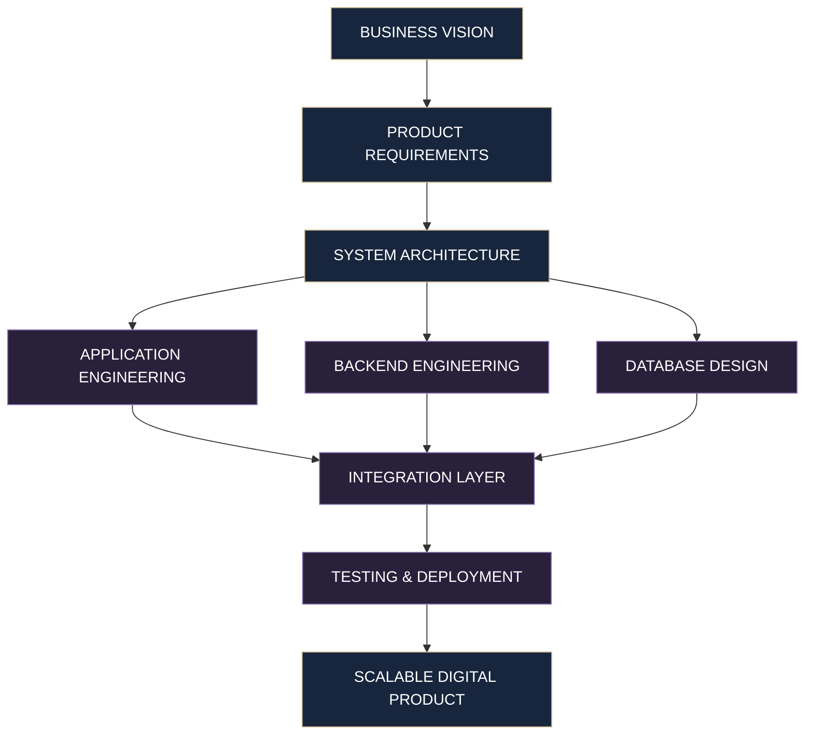
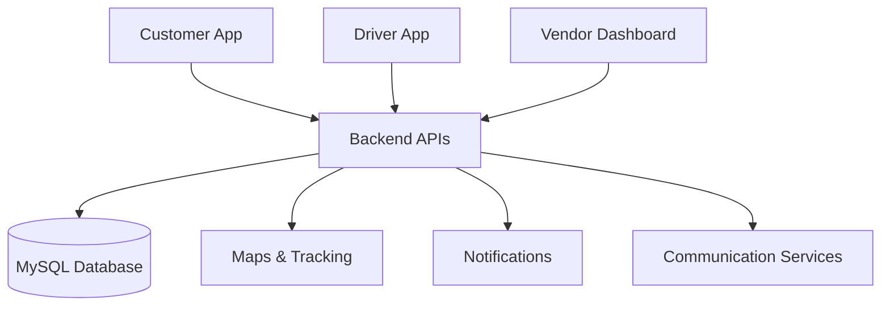
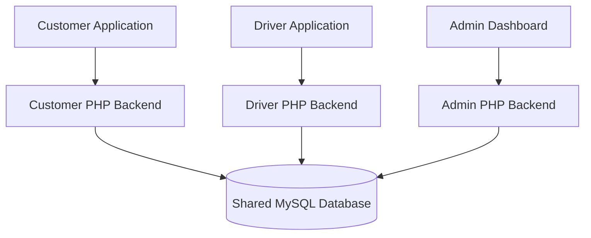
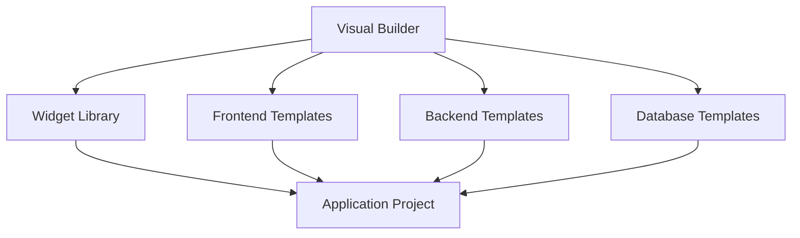

# ISLAM ASHRAF

### SOFTWARE ENGINEER · SYSTEM ARCHITECT · TECHNOLOGY ENTREPRENEUR

**Founder & CEO — Savir Technology**

Building scalable digital ecosystems through engineering, architecture, and innovation.

 

<a href="https://savir-technology.com">OFFICIAL WEBSITE</a>
&nbsp; · &nbsp;
<a href="https://github.com/savir-technology">GITHUB</a>
&nbsp; · &nbsp;
<a href="https://wa.me/201037237626">CONTACT</a>

  

---

## 01. ENGINEERING PROFILE

I am **Islam Ashraf**, a software engineer and technology entrepreneur focused on designing and building complete digital products.

My engineering approach combines application development, backend architecture, database engineering, and business-oriented system design.

Rather than treating software as isolated features, I focus on building interconnected systems with clear responsibilities, maintainable architecture, and room for future growth.

### Engineering Focus

| DOMAIN | ENGINEERING SCOPE |
|---|---|
| Application Engineering | Flutter, Dart, React |
| Backend Engineering | PHP, REST APIs |
| Database Engineering | MySQL, Data Modeling |
| Cloud Services | Firebase |
| System Architecture | Modular & Multi-service Systems |
| Integrations | Payment, Maps, Notifications |

---

## 02. SYSTEM ARCHITECTURE

### Digital Product Engineering Lifecycle

### Engineering Principles

- Separation of concerns.
- Maintainable code organization.
- Secure API communication.
- Relational database integrity.
- Scalable service architecture.
- Reliable third-party integrations.

---

## 03. TECHNOLOGY ARCHITECTURE

### Technology Stack

### Application Layer

- Flutter & Dart
- React
- Responsive interfaces
- Cross-platform development

### Backend Layer

- PHP
- RESTful API architecture
- Authentication and authorization
- Business logic and integrations

### Data Layer

- MySQL
- Relational database design
- Query optimization
- Data modeling

### Infrastructure & Integrations

- Firebase
- Paymob
- Mapbox
- Push notifications
- External APIs

---

## 04. SIGNATURE ENGINEERING PROJECTS

### ROAQ — Multi-Vendor Delivery Ecosystem

An integrated delivery and marketplace platform connecting customers, vendors, restaurants, and drivers.

**System Components**

**Engineering Focus:** Multi-vendor operations, order lifecycle, driver assignment, live tracking, and business management.

---

### VROM VROM — Mobility & Logistics

A ride-hailing and delivery platform designed around independent application services.

**Backend Architecture**

**Engineering Focus:** Independent backend deployments, shared database architecture, live tracking, and operational isolation.

---

### CLEVER CODE — Visual Development Platform

A platform concept for creating applications using reusable components and development templates.

**Product Architecture**

**Engineering Focus:** Component reuse, visual development, application architecture, and development productivity.

---

## 05. GITHUB ENGINEERING ANALYTICS

  

---

## 06. ENGINEERING ROADMAP

| AREA | DIRECTION |
|---|---|
| Software Architecture | Advanced modular systems |
| Backend Engineering | Independent service architecture |
| Application Development | Reusable application components |
| Real-time Systems | Live tracking and communication |
| Cloud Integrations | Connected digital services |
| Product Engineering | Scalable business ecosystems |

---

## 07. PROFESSIONAL CONNECT

**Engineering ideas into reliable digital products.**

[Official Website](https://savir-technology.com) ·
[GitHub](https://github.com/savir-technology) ·
[WhatsApp](https://wa.me/201037237626)

 

**ISLAM ASHRAF**

Founder & CEO — Savir Technology

ENGINEERING · ARCHITECTURE · INNOVATION

